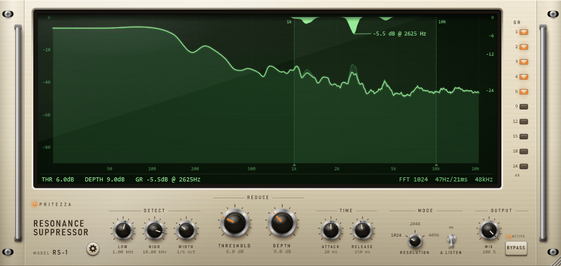

# PRI Resonance Suppressor - macOS ARM Build

A spectral resonance suppressor audio plugin for macOS, optimized for Apple Silicon (M1/M2/M3/M4).

This is a macOS ARM-optimized fork of the [original PRI Resonance Suppressor](https://github.com/pritezza/PRIResonanceSuppressor) by PRITEZZA.

## 🎯 What's New in This Fork

- ✅ **Native macOS ARM support** - Optimized for Apple Silicon
- ✅ **Audio Unit (AU) format** - Native macOS plugin format for Logic Pro, GarageBand
- ✅ **VST3 format** - Cross-platform compatibility
- ✅ **Universal binary support** - Optional Intel + ARM builds
- ✅ **Automated build scripts** - Simple one-command building
- ✅ **Easy installation** - Automated installer with both system and user options
- ✅ **Comprehensive documentation** - Complete guides for building and using

## 🚀 Quick Start

### Prerequisites

1. **macOS 11 (Big Sur) or later** with Apple Silicon
2. **Xcode Command Line Tools**:
   ```bash
   xcode-select --install
   ```
3. **CMake**:
   ```bash
   brew install cmake
   ```

### Build and Install

```bash
# Clone the repository
git clone https://github.com/Makkhus/PRI-Resonance-Suppressor.git
cd PRI-Resonance-Suppressor

# Build (this will automatically clone JUCE)
./build_macos_arm.sh

# Install
sudo ./install_macos.sh
```

That's it! Restart your DAW and look for **PRI Resonance Suppressor** by PRITEZZA.

## 📖 Documentation

- **[QUICKSTART_MACOS.txt](QUICKSTART_MACOS.txt)** - Quick reference guide
- **[README_MACOS.md](README_MACOS.md)** - Complete user guide with features and usage
- **[BUILD_MACOS.md](BUILD_MACOS.md)** - Detailed build instructions
- **[MACOS_SETUP_SUMMARY.md](MACOS_SETUP_SUMMARY.md)** - Technical details of macOS port

## ✨ Features

### Smart Resonance Detection
- Automatically finds and reduces harsh frequencies, ringing, and whistling
- Follows the sound dynamically - no fixed EQ cuts
- Compares every frequency with its neighbors in real-time

### Flexible Controls
- **Detection Range**: Set LOW and HIGH frequency boundaries (25 Hz - 20 kHz)
- **WIDTH**: How narrow a peak must be (1/3 - 1/48 octave)
- **THRESHOLD**: How far a peak must stick out (1 - 20 dB)
- **DEPTH**: Maximum reduction amount (1 - 24 dB)
- **ATTACK/RELEASE**: Speed of reduction (1-200ms / 10-2000ms)

### Visual Feedback
- **Real-time spectrum analyzer** showing input, output, and reduction
- **Three themes**: Vintage, Black, Silver
- **Resizable UI**: 50% to 150% scaling
- **Δ LISTEN mode**: Solo the removed frequencies

### Stereo Processing
- **LINKED**: Same reduction on both channels (default)
- **L/R**: Left and right processed independently
- **M/S**: Mid and side processed independently

## 🎵 Common Use Cases

**Vocal De-Essing:**
```
LOW: 4kHz | HIGH: 10kHz | WIDTH: 1/6 | THRESHOLD: 6dB | DEPTH: 12dB
```

**Acoustic Guitar Harshness:**
```
LOW: 2kHz | HIGH: 8kHz | WIDTH: 1/12 | THRESHOLD: 4dB | DEPTH: 9dB
```

**Overhead Cymbal Control:**
```
LOW: 5kHz | HIGH: 15kHz | WIDTH: 1/6 | THRESHOLD: 6dB | DEPTH: 15dB
```

**General Mix Polish:**
```
LOW: 1kHz | HIGH: 16kHz | WIDTH: 1/6 | THRESHOLD: 8dB | DEPTH: 6dB | MIX: 50%
```

## 🎛️ DAW Compatibility

Tested and working with:
- Logic Pro (AU)
- Ableton Live (VST3/AU)
- FL Studio (VST3/AU)
- Reaper (VST3/AU)
- Pro Tools 2023.6+ (VST3/AU)
- Cubase (VST3)
- Studio One (VST3/AU)

## 📍 Installation Locations

### Audio Unit (AU)
- System: `/Library/Audio/Plug-Ins/Components/`
- User: `~/Library/Audio/Plug-Ins/Components/`

### VST3
- System: `/Library/Audio/Plug-Ins/VST3/`
- User: `~/Library/Audio/Plug-Ins/VST3/`

### Settings
- `~/Library/Application Support/PRITEZZA/PRIResonanceSuppressor.settings`

## 🔧 Build Options

### ARM64 Build (Default)
```bash
./build_macos_arm.sh
```

### Universal Binary (Intel + ARM)
```bash
./build_macos_arm.sh Release universal
```

### Debug Build (Faster compilation)
```bash
./build_macos_arm.sh Debug
```

### Manual Build
See [BUILD_MACOS.md](BUILD_MACOS.md) for detailed manual build instructions.

## 🐛 Troubleshooting

### Plugin not showing in DAW?
1. Restart your DAW completely
2. Rescan plugins in DAW preferences
3. Remove quarantine attributes:
   ```bash
   sudo xattr -cr "/Library/Audio/Plug-Ins/Components/PRI Resonance Suppressor.component"
   sudo xattr -cr "/Library/Audio/Plug-Ins/VST3/PRI Resonance Suppressor.vst3"
   ```

### Build errors?
1. Verify Xcode tools: `xcode-select -p`
2. Update CMake: `brew upgrade cmake`
3. Clean build: `rm -rf build && ./build_macos_arm.sh`

See [BUILD_MACOS.md](BUILD_MACOS.md) for more troubleshooting.

## 🗑️ Uninstall

```bash
# Remove plugins
sudo rm -rf "/Library/Audio/Plug-Ins/Components/PRI Resonance Suppressor.component"
sudo rm -rf "/Library/Audio/Plug-Ins/VST3/PRI Resonance Suppressor.vst3"

# Remove settings (optional)
rm -rf "$HOME/Library/Application Support/PRITEZZA"
```

## ⚡ Performance

- **CPU Usage**: < 1% on Apple Silicon for audio processing
- **Display**: 1-3% (adjustable via DISPLAY RATE setting)
- **Latency**: 23ms @ 1024 samples (automatically compensated)

## 📄 License

Copyright (C) 2026 PRITEZZA

This program is free software: you can redistribute it and/or modify it under the terms of the GNU Affero General Public License version 3 (AGPLv3).

Built with [JUCE](https://juce.com) framework under AGPLv3.

## 🙏 Credits

- **Original Plugin**: [PRITEZZA](https://github.com/pritezza)
- **macOS ARM Port**: This fork
- **Framework**: [JUCE](https://github.com/juce-framework/JUCE)

## 🔗 Links

- [Original Repository](https://github.com/pritezza/PRIResonanceSuppressor)
- [JUCE Framework](https://juce.com)
- [Issue Tracker](https://github.com/Makkhus/PRI-Resonance-Suppressor/issues)

## 📸 Screenshots



*Real-time resonance detection and suppression*

---

**Made with ❤️ for Apple Silicon**
